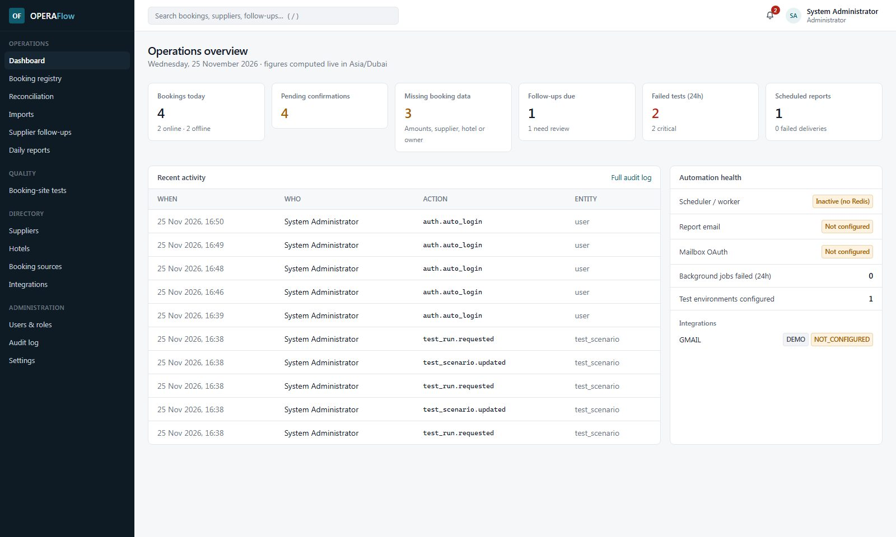
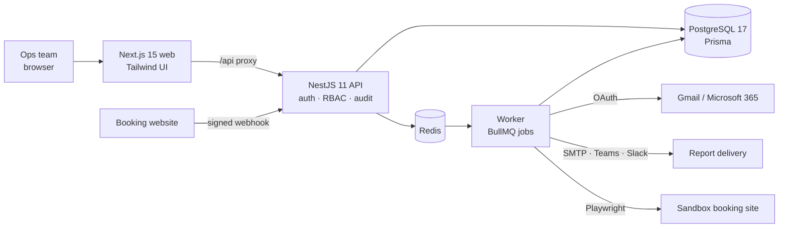
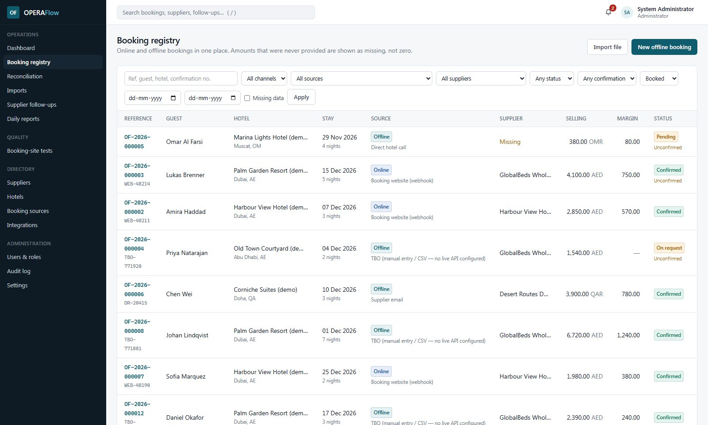
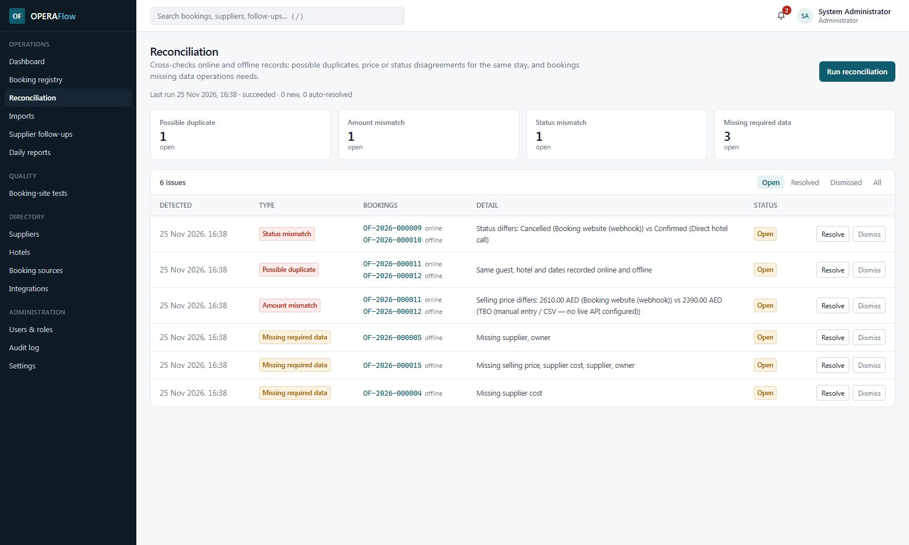
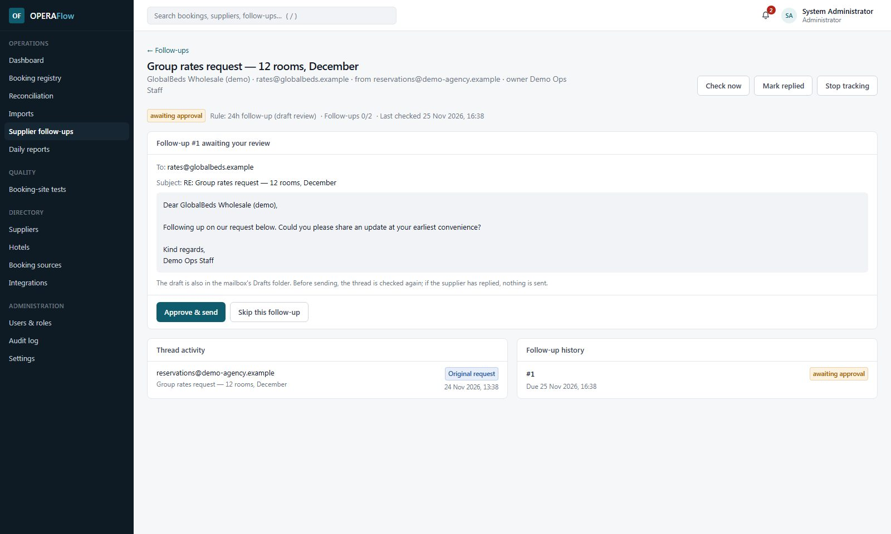
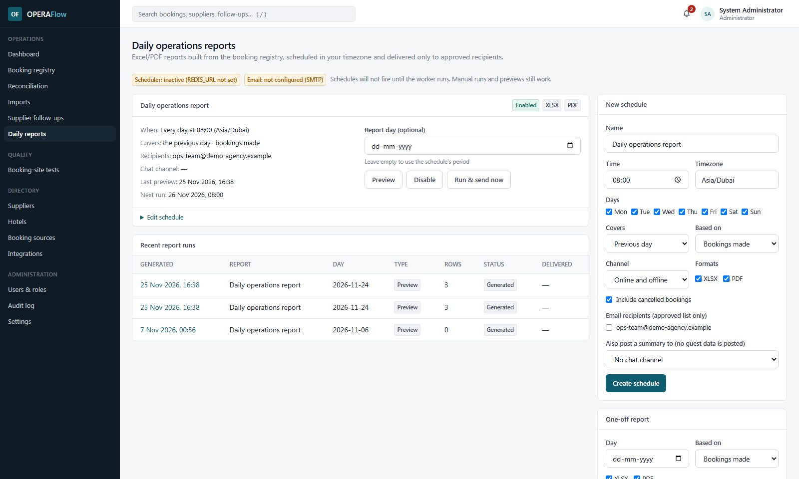
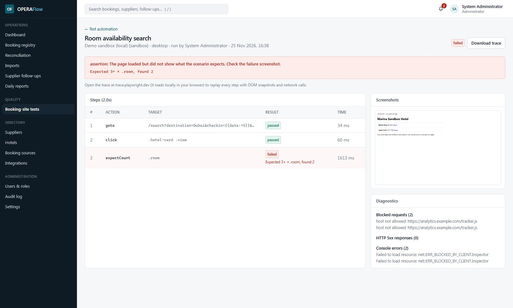
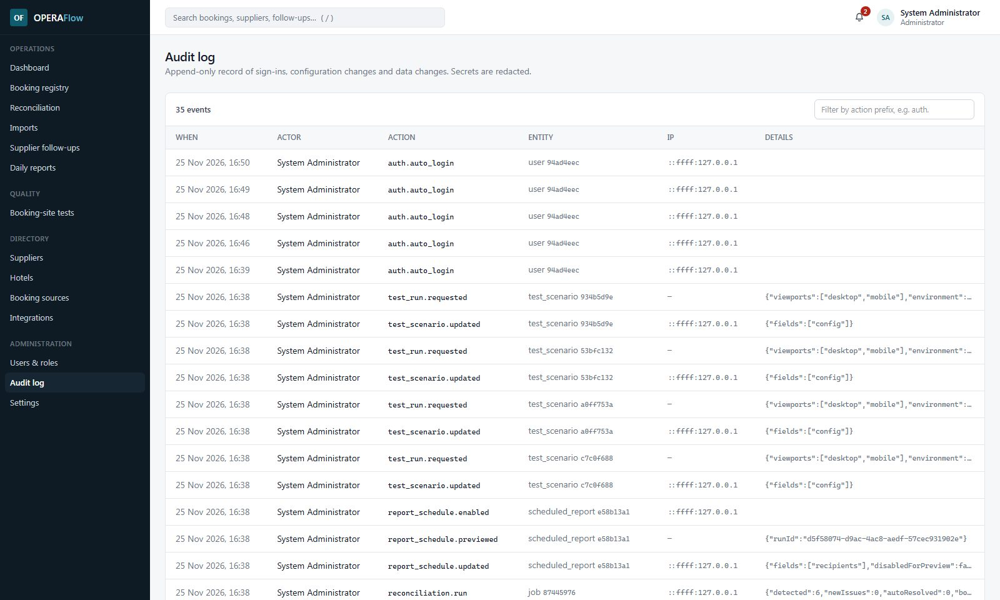

<div align="center">

# OPERAFlow

**Travel operations automation platform: one secure backend for bookings, supplier follow-ups, daily reports and booking-site testing.**

[](https://github.com/katrine-daniel/OPERAFlow/actions/workflows/ci.yml)


### [▶ Try the interactive demo](https://katrine-daniel.github.io/OPERAFlow/) · [Screenshot tour](https://katrine-daniel.github.io/OPERAFlow/tour.html) · [Architecture](docs/ARCHITECTURE.md)

<a href="https://katrine-daniel.github.io/OPERAFlow/"></a>

</div>

---

## The problem

A travel company receives bookings from many places: its own website, B2B portals like TBO, direct hotel deals and supplier emails. Operations teams track them in spreadsheets, chase suppliers by hand for confirmations, build the daily report manually every morning, and only find out the booking website is broken when customers complain.

**OPERAFlow replaces that with one system:**

| Module | What it does |
|---|---|
| 📒 **Unified booking registry** | Online (signed webhook, API, CSV/Excel import) and offline bookings in one place. Duplicate detection, missing-data flags, margin calculation and **automatic reconciliation** between sources. |
| ✉️ **Supplier follow-ups** | Connects to Gmail / Microsoft 365 (OAuth), tracks each supplier thread, classifies replies (confirmed, out-of-office, bounce, unclear) and sends follow-ups in business hours. Draft-review by default; unattended sending needs admin approval. |
| 📊 **Daily operations reports** | Timezone-aware scheduled Excel and PDF reports (arrivals, pending confirmations, margins) delivered by email, Teams or Slack, with full delivery history and retries. |
| 🧪 **Booking-site test automation** | Playwright journeys (search → book → pay) against an authorised sandbox, with screenshots on failure. Safety guards block real bookings and real cards. |

## Highlights

- **Security first:** Argon2id passwords, hashed session tokens, account lockout, CSRF origin checks, role-based access (Admin / Ops manager / Ops staff / QA), AES-256-GCM encryption for stored secrets, strict CSP, rate limiting.
- **Tamper-proof audit trail:** every change is logged, and a database trigger makes the log append-only.
- **Data integrity:** idempotency keys, optimistic locking, database CHECK constraints. Missing values are flagged, never invented.
- **Safe automation:** test runs can only make bookings on sandbox hosts with Luhn-checked test cards; follow-ups never go to unrelated recipients.
- **Production-ready setup:** background worker (BullMQ/Redis), JSON logs with request IDs, `/metrics`, readiness checks, data retention, backups, Docker Compose with Caddy TLS.
- **Tested for real:** integration tests run against real PostgreSQL 17, a real SMTP server and real Chromium, plus browser E2E tests on desktop and mobile.

## Architecture



## Screenshots

| Booking registry | Reconciliation | Supplier follow-up review |
|---|---|---|
|  |  |  |
| **Scheduled reports** | **Test run with failure screenshot** | **Audit trail** |
|  |  |  |

All screenshots use fictional demo data. More in the [screenshot tour](https://katrine-daniel.github.io/OPERAFlow/tour.html).

## Tech stack

| Layer | Technology |
|---|---|
| Frontend | Next.js 15, React, Tailwind CSS 4 |
| Backend | NestJS 11, zod 4 validation |
| Database | PostgreSQL 17, Prisma 6, hand-written SQL migrations |
| Jobs | BullMQ + Redis worker |
| Automation | Playwright |
| Files | exceljs, pdfkit |
| Quality | Vitest, Playwright Test, ESLint, TypeScript strict, dependency audit gate |
| Deployment | Docker Compose, Caddy (automatic TLS), GitHub Actions CI |

## About the live demo

[The demo](https://katrine-daniel.github.io/OPERAFlow/) runs **entirely in your browser** (GitHub Pages: `index.html` + `demo/`) with fictional sample data and the same business rules as the real app: duplicate detection, missing data, margins, reconciliation and role permissions. Switch roles from the top bar. Changes stay in your browser, and nothing is sent anywhere.

The full application needs a server (API + database), see [Deployment](#deployment).

## Project status

All 6 planned phases are built and tested. See [docs/STATUS.md](docs/STATUS.md) for detailed verification results.

> **Honest note:** the app has **not yet been deployed with Docker or connected to live Gmail, Microsoft 365 or a live booking site**. Those need real environment credentials ([docs/CREDENTIALS.md](docs/CREDENTIALS.md)). Until then, these integrations are tested with test servers, mocks and a sandbox site.

## Repository layout

```
apps/api        NestJS REST API + background worker
apps/web        Next.js 15 + Tailwind UI (proxies /api/* to the API)
packages/db     Prisma schema, SQL migrations, seed
packages/shared Role/permission matrix, zod schemas, masking and timezone helpers
e2e/            Playwright browser end-to-end tests
demo/           In-browser interactive demo (GitHub Pages)
scripts/        Local PostgreSQL, local starter, audit gate, showcase tools
deploy/         Caddyfile, Docker env template, backup script
docs/           Architecture, deployment, security, credentials, operations, status
```

## Getting started

Requires Node.js ≥ 20.11. No Docker needed for local development: a real PostgreSQL 17 runs embedded.

```bash
npm install
cp .env.example .env        # then fill ENCRYPTION_KEY (command is in the file)
npm run dev:db              # PostgreSQL on port 5433, leave running
```

In a second terminal:

```bash
npm run db:generate && npm run build -w @operaflow/shared && npm run db:migrate && npm run db:seed
npm run dev:api
npm run dev:web             # open http://localhost:3000
```

Create `packages/db/.env` containing only the `DATABASE_URL` line (the Prisma CLI reads it there). The seeded admin password is written to `.local/seed-credentials.txt` (gitignored), unless you set `SEED_ADMIN_PASSWORD`.

On an already set-up Windows machine, `start-operaflow.cmd` (or `npm run local`) starts everything with one command.

## Quality gates

```bash
npm run lint
npm run typecheck
npm test                         # unit + integration on real PostgreSQL (refuses any DB not named *_test)
npx playwright install chromium  # once
npm run e2e                      # browser E2E: own API on :4100, web on :3100
node scripts/audit-check.mjs     # dependency gate
```

CI runs all of these, then builds the Docker images and validates the compose file.

## Deployment

Docker Compose with PostgreSQL, Redis, a migration job, API, worker, web and Caddy (TLS). See [docs/DEPLOYMENT.md](docs/DEPLOYMENT.md).

## Documentation

| Document | For |
|---|---|
| [STATUS.md](docs/STATUS.md) | What is done, verification results, limitations |
| [ARCHITECTURE.md](docs/ARCHITECTURE.md) | Design decisions, roles, data model |
| [DEPLOYMENT.md](docs/DEPLOYMENT.md) | Installing, upgrading, backups, monitoring |
| [OPERATIONS.md](docs/OPERATIONS.md) | Day-to-day use by operations, managers, QA, admins |
| [CREDENTIALS.md](docs/CREDENTIALS.md) | Every external credential and where it comes from |
| [SECURITY.md](docs/SECURITY.md) | Security checklist |
| [WEBHOOK.md](docs/WEBHOOK.md) | Spec for the booking website's signed webhook |

To refresh the tour screenshots: `npm run seed:demo && node scripts/showcase/prepare.mjs && node scripts/showcase/screenshots.mjs` (remove the demo data afterwards with `npm run seed:demo -- --remove`).
